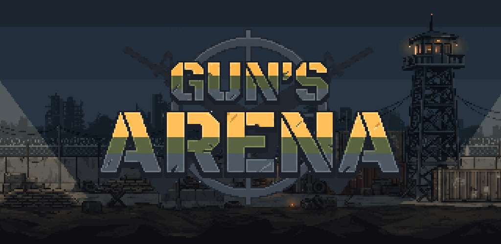
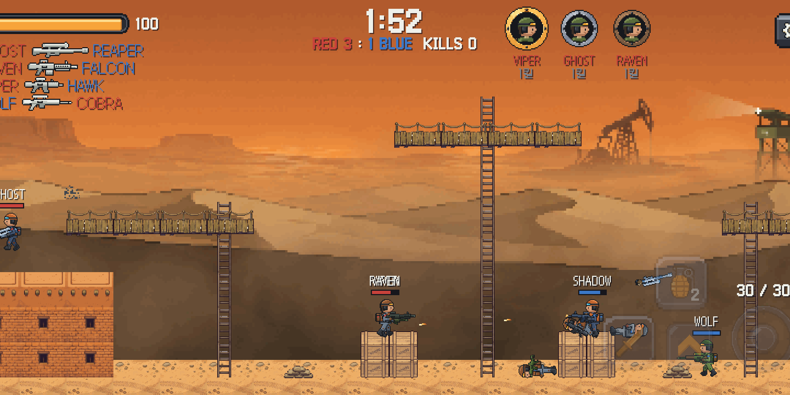
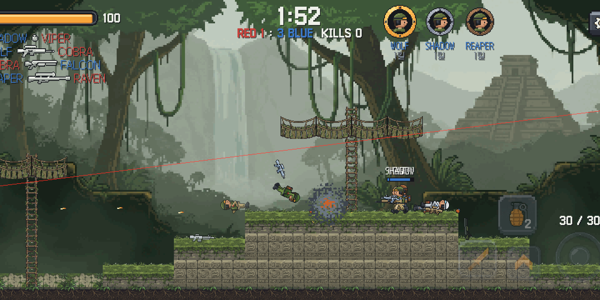
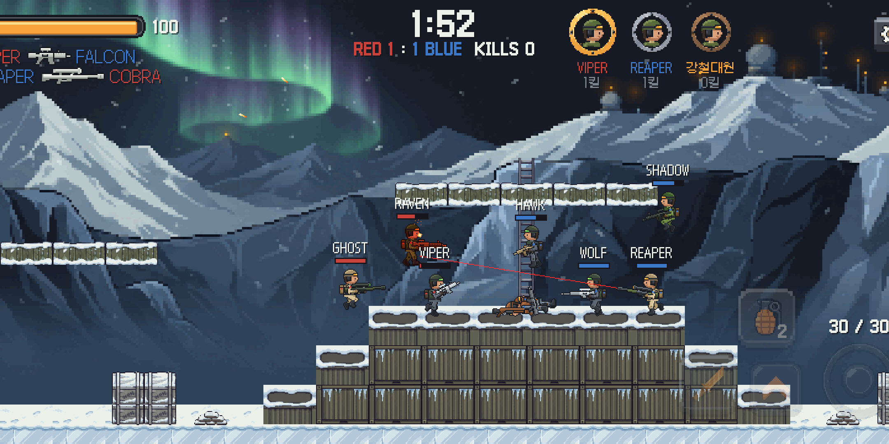
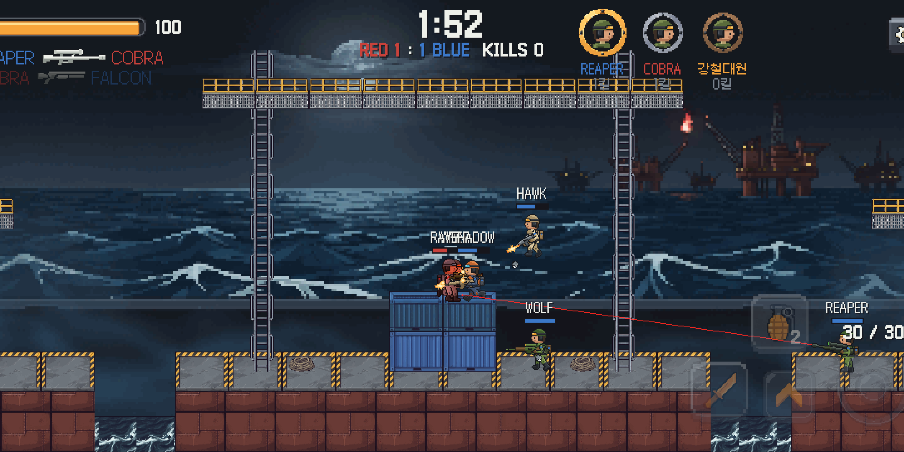
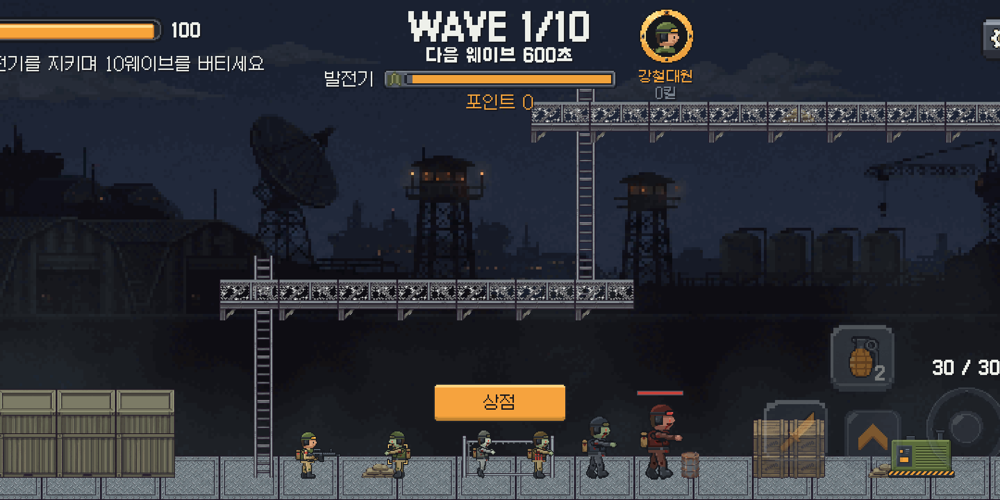
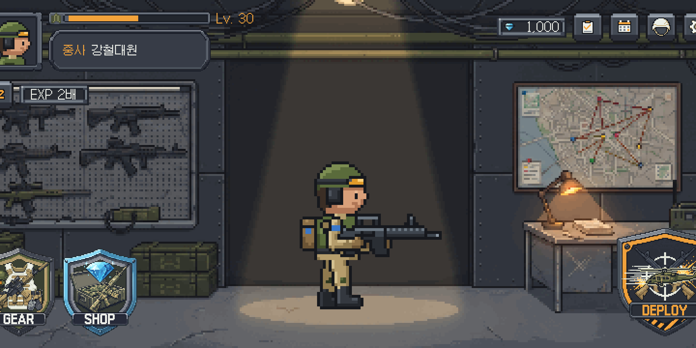
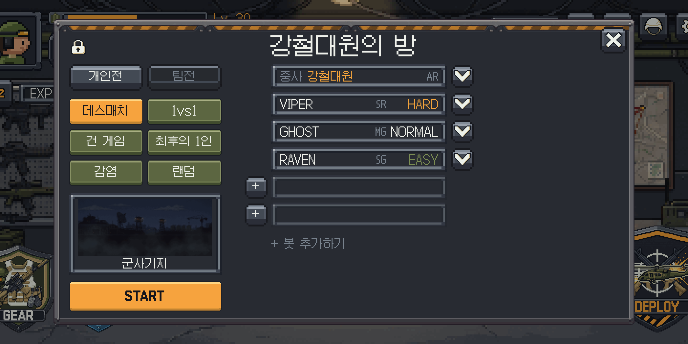
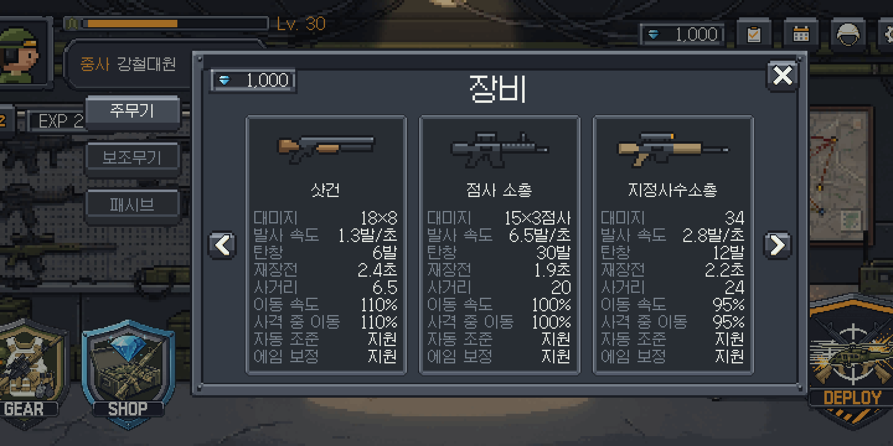

# Gun's Arena

특수부대 군인이 되어 싸우는 **모바일 2D 횡스크롤 픽셀 총격전**입니다. (일곱 번째 Unity 2D 게임, Android)

무기를 고르고, 맵을 달리고, 사다리를 오르며 상대를 쓰러뜨리세요. 친구와 온라인으로 붙거나, 봇과 연습하거나, 함께 좀비 웨이브를 막을 수 있습니다.

## 특징

- **온라인 대전**: 방을 만들고 친구를 초대해 사람끼리 싸웁니다. 사람이 모자라면 봇을 채우고, 인터넷이 없어도 봇과 혼자 연습할 수 있습니다.
- **다양한 모드**
  - 개인전: 데스매치, 1대1(라운드제), 건 게임, 최후의 1인, 감염
  - 팀전: 팀 데스매치, 점령전, 폭탄 해체, 확인 사살
  - 협동: 기지 방어전(발전기를 지키며 좀비 10웨이브, 포인트로 방벽·터렛 설치)
- **무기**: 주무기 일곱(돌격소총, 기관단총, 샷건, 점사 소총, 지정사수소총, 기관총, 저격소총), 보조무기(칼, 권총, 리볼버, 기관권총, 산탄 권총)와 패시브 능력을 조합합니다.
- **여덟 전장**: 군사기지, 사막 전초기지, 해상 시추선, 공중 요새, 극지 기지, 정글 유적, 폐허 시가지, 달리는 열차. 떨어지면 끝나는 맵도 있습니다.
- **성장과 꾸미기**: 레벨을 올려 계급을 달고 무기를 엽니다. 출석과 임무로 다이아를 모아 군복·총·수류탄 스킨을 삽니다.
- **모바일에 맞춘 조작**: 누른 곳에 나오는 이동 조이스틱, 누르기만 하면 되는 자동 조준, 끌어서 직접 겨누기, 버튼 크기·자리·투명도 설정, 처음 하는 사람을 위한 기초 훈련.

## 스크린샷

| | |
|---|---|
|  |  |
|  |  |
|  |  |
|  |  |

## 만든 방법

- **엔진**: Unity 6000.3 (URP 2D), 가로 화면 안드로이드
- **온라인**: Unity Gaming Services(Lobby, Relay, Friends, Cloud Save, Cloud Code)와 Netcode for GameObjects. 맞았는지는 쏜 사람 화면을 기준으로 정하고 방장이 검사합니다.
- **그림**: 군인·총·소품 스프라이트는 Python 코드로 픽셀 하나하나 생성했습니다. 배경·UI·맵 타일은 AI 이미지를 실제 픽셀 격자로 변환해 다듬었습니다.
- **소리**: 효과음과 배경음악은 AI 도구로 만들어 편집했습니다.
- **글꼴**: [갈무리(Galmuri)](https://github.com/quiple/galmuri) 픽셀 폰트, SIL Open Font License 1.1

## 문의

skarnd814@gmail.com
